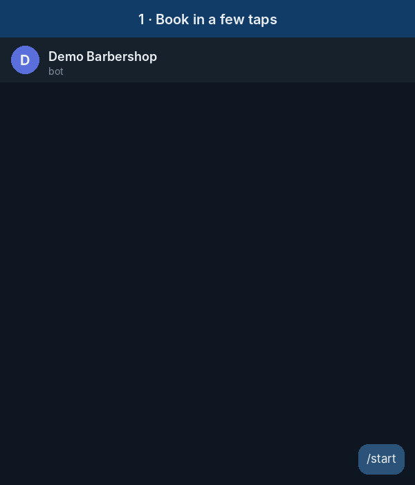

# Booking Bot

A Telegram bot for **online appointments with prepaid deposits, automatic reminders and reviews** — plus an owner panel right inside Telegram.

Built for barbershops, beauty salons, clinics, tutors, fitness studios, consultants — any business that works by appointment and loses money on no-shows.

<p align="center"></p>

## Features

**📅 Booking in a few taps**
- Service → specialist → day → time → confirm
- Only real free slots are shown: working hours, service duration, existing bookings and a minimum lead time are all taken into account
- Each specialist has an independent schedule
- Clients see and cancel their bookings in `/start → My bookings`

**💳 Deposits (Telegram Payments, e.g. Stripe)**
- Optional prepayment per service, paid inside Telegram
- The slot is held for 15 minutes while the client pays, then released automatically
- Payment is re-validated right before charging (slot still free, amount unchanged)
- Cancellation policy: refundable up to N hours before the visit, the owner gets a refund note with the payment ID
- Works without payments too: leave the provider token empty and bookings are confirmed instantly

**🔔 Reminders & reviews**
- Reminder 24 hours before with "I'll be there / Cancel" buttons, and another 2 hours before
- After the visit the client is asked to rate it (1–5)
- 4–5 stars → invited to leave a public review (e.g. Google Maps link)
- 1–3 stars → the owner is alerted privately to follow up before it turns into a bad public review

**🛠 Owner panel**
- Instant notification about every new booking and cancellation
- `/today`, `/tomorrow` — schedule with totals, cancel any booking (client is notified)
- `/services`, `/addservice` — enable/disable and add services with duration, price and deposit
- `/staff`, `/addstaff` — manage specialists
- `/rating` — average client rating

## Tech stack

Python 3.13 · aiogram 3 · SQLAlchemy 2 (async) · PostgreSQL / SQLite · Telegram Payments · Docker Compose · pytest

```
bot/
├── handlers/      # client booking flow, payments, owner panel
├── services/      # slot engine, booking rules, scheduler, formatting
├── db/            # models, repository queries, demo seed
├── keyboards.py   # inline keyboards and typed callback data
└── config.py      # all settings from environment variables
tests/             # slot engine, scheduler, end-to-end flows with mocked Telegram API
```

## Quick start

1. Create a bot with [@BotFather](https://t.me/BotFather) and copy the token.
2. *(Optional)* Enable payments: BotFather → your bot → **Payments** → choose Stripe → **Stripe TEST** and copy the provider token. Test card: `4242 4242 4242 4242`.
3. Configure:
   ```bash
   cp .env.example .env   # set BOT_TOKEN, OWNER_IDS, business hours, PAYMENT_PROVIDER_TOKEN
   ```
4. Run with Docker (PostgreSQL included):
   ```bash
   docker compose up -d --build
   ```
   Or locally with SQLite:
   ```bash
   python -m venv .venv && source .venv/bin/activate
   pip install -r requirements.txt
   python -m bot
   ```

On first start the bot creates demo services and specialists (`SEED_DEMO=true`), so you can try it right away.

## Configuration

| Variable | Default | Description |
|---|---|---|
| `BOT_TOKEN` | — | Token from @BotFather |
| `OWNER_IDS` | `[]` | Telegram IDs of the owner/managers |
| `BUSINESS_NAME` | `Demo Barbershop` | Shown to clients |
| `TIMEZONE` | `Europe/London` | Business time zone (IANA name) |
| `WORK_DAYS` | `[0,1,2,3,4,5]` | Working days, Monday = 0 |
| `WORK_START` / `WORK_END` | `10:00` / `20:00` | Working hours |
| `SLOT_STEP_MINUTES` | `30` | Grid of possible start times |
| `BOOKING_DAYS_AHEAD` | `7` | How far ahead clients can book |
| `MIN_LEAD_MINUTES` | `60` | Earliest bookable slot from now |
| `PAYMENT_PROVIDER_TOKEN` | empty | Telegram Payments provider token; empty = no deposits |
| `CURRENCY` | `USD` | ISO currency code |
| `PENDING_PAYMENT_MINUTES` | `15` | How long a slot is held while paying |
| `FREE_CANCEL_HOURS` | `24` | Deposit is refundable if cancelled earlier |
| `REVIEW_URL` | empty | Public review link for happy clients |
| `REVIEW_DELAY_MINUTES` | `120` | When to ask for a rating after the visit |
| `DATABASE_URL` | SQLite file | Any SQLAlchemy async URL |

## Tests

```bash
pip install -r requirements-dev.txt
pytest
```

## Possible extensions

Per-specialist working hours and days off · Google Calendar sync · web admin dashboard · Telegram Mini App booking UI · SMS/WhatsApp reminders · multi-location / SaaS mode · automatic refunds via provider API · loyalty discounts.
